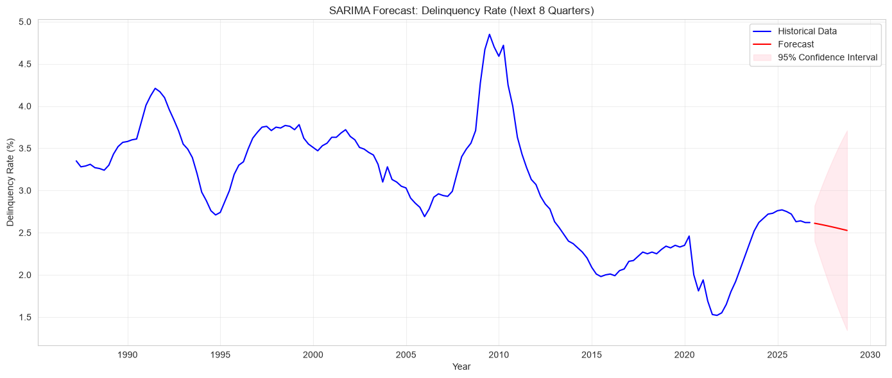
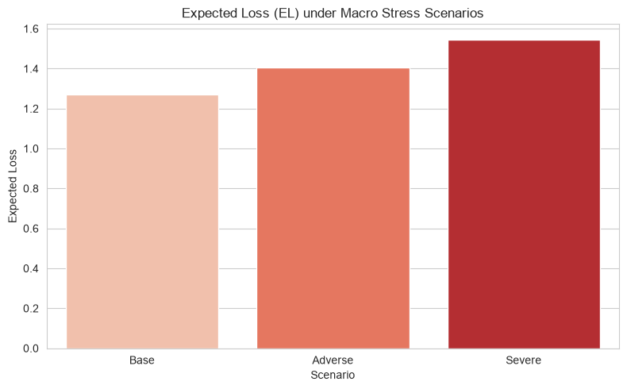

# Creadit Risk Analysis

A quantitative analysis of consumer credit risk using public macroeconomic data.
The project forecasts delinquency rates with SARIMA and performs stress testing
under adverse and severe macro scenarios.

## Motivation

This project demonstrates the workflow of a credit risk analyst:
- collecting and structuring external data,
- building and validating a PD (Probability of Default) proxy model,
- performing forward-looking stress tests aligned with IFRS 9 principles.

## Data

All data is fetched from [FRED](https://fred.stlouisfed.org/) (Federal Reserve Economic Data):

| Series | Description | Frequency |
|---|---|---|
| `DRCLACBS` | Delinquency Rate on Consumer Loans, All Commercial Banks | Quarterly |
| `UNRATE` | US Unemployment Rate | Monthly |
| `A191RL1Q225SBEA` | Real GDP Growth | Quarterly |

The delinquency rate is used as a **proxy for PD**. Unemployment and GDP growth
serve as macroeconomic explanatory variables in the stress testing framework.

## Methodology

1. **Data preparation** – resampling to quarterly frequency, interpolation of missing values.
2. **Stationarity testing** – Augmented Dickey-Fuller test, ACF/PACF analysis.
3. **PD forecasting** – SARIMA model selected by grid search over (p,d,q)(P,D,Q,s) minimizing AIC.
4. **Model validation** – MAPE on a hold-out period, Ljung-Box test on residuals, QQ-plot.
5. **Stress testing** – OLS regression of delinquency on macroeconomic variables,
   followed by scenario-based EL calculation:

   EL = PD × LGD × EAD

   with LGD = 45% and EAD = 100 (normalized).

## Results

### 1. PD Forecast (SARIMA)
The SARIMA(2,0,1)(0,0,0,4) model achieved an impressive out-of-sample **MAPE of ~2.03%**, successfully capturing cyclical fluctuations in consumer credit risk.

### 2. Stress Testing & Expected Loss
A 1pp increase in unemployment was statistically linked to a ~0.15pp increase in delinquency. 
Under a **Severe scenario** (Unemployment +4pp, GDP -3pp), the Expected Loss increases by approximately **22%** compared to the baseline.

### 3. Model Limitations
While excellent at normal forecasting, the residual diagnostics (Ljung-Box p-value < 0.05) revealed that the SARIMA model struggles to predict extreme structural breaks (e.g., the 2008 crash). This validates the necessity of forward-looking scenario analysis, as required by IFRS 9.

## Project structure
credit-risk/
+-- data/
+-- notebooks/
+-- src/
+-- output/
+-- README.md
+-- requirements.txt
